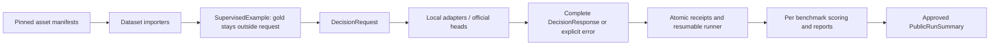

# Shared evaluation architecture

Core imports Pydantic + HTTPX only; heavy inference dependencies load lazily. Request/response schemas preserve candidate IDs,
Boolean semantics and numeric ordinal levels. Native head, single-token vocabulary readout and candidate sequence likelihood
are separate probability kinds. Gold and teacher distributions do not enter adapters.

Data and model files are downloaded through fixed manifests. The reference implementation uses HF-compatible checkpoints,
Transformers, Safetensors and controlled image paths. Special loader source is separately pinned and verified.
Trainer/PEFT and optional candidate heads reuse this request contract and external artifact store in Lab.
Workers with conflicting dependencies can run in isolated environments; no shared global package mutation is required.

Latency denotes synchronized request wall time; load time and peak allocated memory are separate. Failed attempts remain in
coverage denominators; absent probabilities and unknown costs remain null. API execution is disabled in this release.
